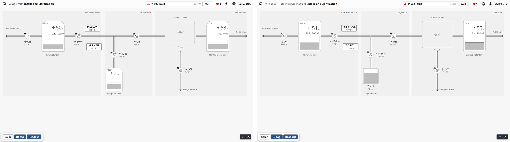
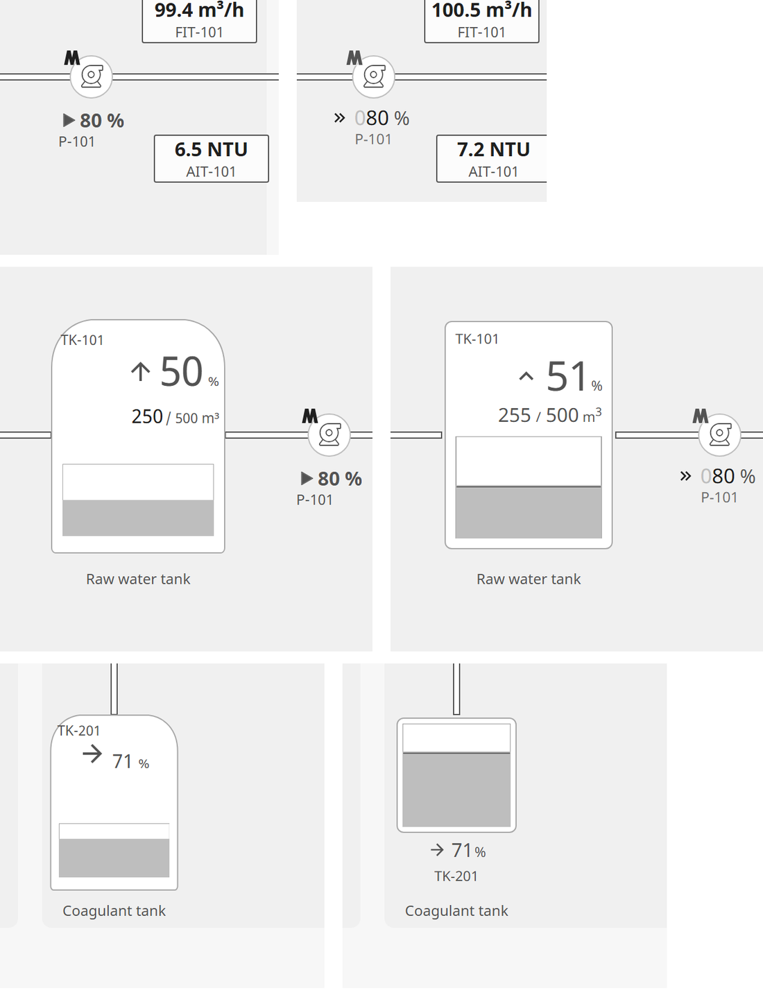
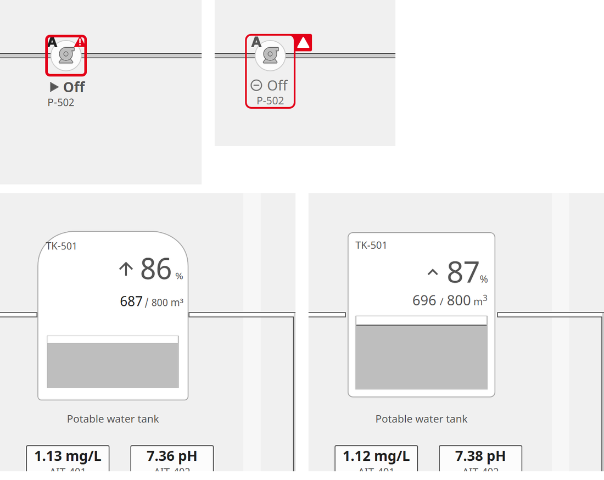
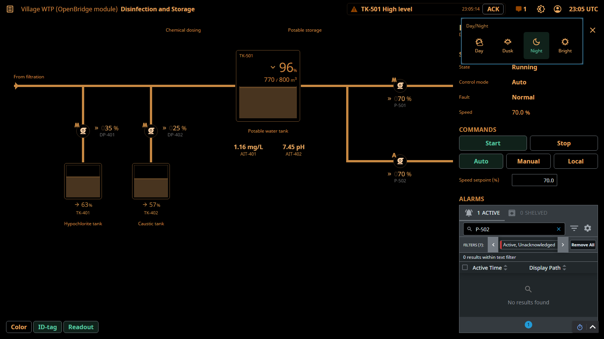

# 12 Assessment Report: Cadre OpenBridge Module Spike

| Field | Value |
|---|---|
| Document ID | COB-WIKI-12 |
| Revision | F |
| Status | In review |
| Issued | 2026-10-07 |
| Prepared by | Cadre-Sandbox-OpenBridge, at the owner's request |
| Gateway | `Ignition-PCS_DEV_Station`, Ignition 8.3.6, Perspective 3.3.6, trial licence |
| Register | COB-070 (the spike); COB-071 to COB-075 (follow-up) |
| Decisions | COBD-011 |
| Outstanding inputs | N-COB-6 (Designer check); N-COB-5 decided 2026-10-09 |

## 1. Purpose and Scope

This report records a spike: a Perspective module of Cadre's own that wraps two OpenBridge web
components, the pump and the tank, and the comparison of that module with the stock component
library of `cadre_hmi_base` on the same screens. It establishes whether such a module works on the
8.3.6 gateway, and what it changes in rendering, integration, page cost, deployment and effort.

Out of scope: components other than the pump and the tank; the vendor's "OpenBridge for Ignition"
module, which is neither used nor installed; Designer editing tools; production signing and
release management.

## 2. Summary of Findings

1. **The module works on Ignition 8.3.6.** The OpenBridge elements `obc-pump` and
   `obc-automation-tank` render inside Perspective, bind to tags, open the faceplate dock and
   follow the Cadre palettes. The water treatment sample rendered through the module passes every
   gate the stock rendering passes: G0 to G8, the functional walk G10 (9 of 9) and the faceplate
   sweep G11 (26 of 26 devices).
2. **The module draws the OpenBridge detail that the stock library approximates.** The speed
   readout with its double chevron and hinted zeros, the alert frame around symbol and readout
   with its flap outside the corner, the tank vessel and value row, and the OpenBridge type weights
   all come from OpenBridge's own code. Registered gaps COB-032, COB-033, COB-034 and COB-068 close
   for the wrapped components; COB-030 (medium size) becomes one property.
3. **The descriptors and the interface of the Cadre tools do not change.** One generator option,
   `--render module`, draws pumps and tanks with the module and every other kind as before.
4. **Page cost falls in components and rises in first-load transfer.** Pages with seven module
   symbols carry 54 to 67 per cent fewer Perspective components. Load time shows no established
   difference at this scale. A cold load transfers 754 KB more: the module's script, stylesheet and font.
5. **Deployment gains a restart.** Installing or upgrading a module registers a required gateway
   restart; the restart took about 90 s and interrupted every project on the gateway. The module
   is signed, and each gateway trusts its certificate once.
6. **The effort is small.** Three Java classes (142 lines) and a 301-line generator, which derives
   the property schemas, the browser wrappers and a scoped stylesheet from the OpenBridge
   manifest. The first build took 5 min 41 s including the download of the software development
   kit; a full rebuild takes 13 s.

## 3. Background

The stock library redraws each OpenBridge component from stock Perspective parts, using the
OpenBridge tokens and icons only; page 09 measured the remaining differences against the vendor's
demo. A Perspective module can instead host the OpenBridge web components themselves, which are
Apache-2.0 at the release pinned by COBD-003. The owner asked for a spike on the pump and the tank,
compared with the current library, before any decision. The owner's field practice, adding a pump
or a button after handover, is the main operational concern (section 9).

## 4. Terms and Abbreviations

The terms below are used throughout the report.

Table 1. Terms and abbreviations.

| Term | Meaning |
|---|---|
| API | Application programming interface |
| CSS | Cascading Style Sheets |
| DOM | Document Object Model; the shadow DOM is the private element tree of a web component |
| EULA | End user licence agreement |
| JDK | Java Development Kit |
| HTTP | Hypertext Transfer Protocol |
| KB | Kilobyte, 1,024 bytes |
| MB | Megabyte, 1,048,576 bytes |
| Manifest | `custom-elements.json`, the machine-readable description of every OpenBridge element |
| Module | An Ignition module (`.modl` file) installed on the gateway |
| REST | Representational state transfer; the gateway's HTTP API |
| SDK | Software development kit; here the Ignition 8.3.6 SDK |
| Stock rendering | The water treatment sample drawn with the library views of `cadre_hmi_base` |
| Module rendering | The same sample with pumps and tanks drawn by the module |
| G0 to G11 | The gates of page 08 section 5 |

## 5. Build

### 5.1 Module Structure

The module follows the Ignition SDK's minimal Perspective component example: a gateway hook
registers the components and serves the browser files, a designer hook adds them to the Designer's
component palette, and one script and one stylesheet carry the browser side. No Inductive
Automation npm package is needed: the script uses the `PerspectiveClient` and `React` objects that
the Perspective client exposes (GF-31).

Table 2. Module parts.

| Part | Content | Size |
|---|---|---|
| `module/common` | `CadreOb`: the two component descriptors and the browser resources | 50 lines |
| `module/gateway` | `CadreObGatewayHook`: registration, files served under `/res/cadreob/` | 61 lines |
| `module/designer` | `CadreObDesignerHook`: the "Cadre OpenBridge" palette category | 31 lines |
| `mounted/js/cadre-ob.js` | The OpenBridge pump and tank with their dependencies, then the generated wrappers | 544 KB, 138 KB compressed |
| `mounted/css/cadre-ob.css` | OpenBridge's stylesheet, scoped and trimmed | 47 KB, 5 KB compressed |
| `mounted/fonts/NotoSans-OB.ttf` | OpenBridge's variable Noto Sans | 611 KB |
| `CadreOpenBridge.modl` | The signed module | 492 KB |

### 5.2 Generation from the OpenBridge Manifest

`module/tools/gen_module_assets.py` reads the manifest of OpenBridge 2.0.0-next.155 (285 custom
elements) and writes everything per element; adding an element is one entry in its list.

1. **Property schemas.** Each element attribute becomes a Perspective property with its type, its
   enumerated domain (read from OpenBridge's enum declarations) and its default (measured by
   creating each element in a browser, `measure_defaults.py`): 27 properties for the pump, 30 for
   the tank, plus `componentSize` and `style`. The schemas drive the Designer property editor, the
   gateway's validation, and gate G1.
2. **Wrappers.** One React wrapper per element renders the element inside the Perspective component
   box and copies the properties onto it; DOM events reach the component's event scripts.
3. **Stylesheet.** OpenBridge declares its palettes and sizes on `:root` and some variables on
   every element. Loaded as shipped, these rules would reach every page of a project. The generator
   keeps only the 216 of 2,828 variables the bundled elements use, declares them on the module's
   wrapper, and keys the palettes to the Cadre palette classes, so palette switching needs no
   script. The stylesheet falls from 777 KB to 47 KB.
4. **Font.** The variable Noto Sans shipped with OpenBridge is served under its own family name,
   so the OpenBridge weights 370 and 570 render exactly (GF-26) without changing any other text.

### 5.3 Signing and Installation

The module is signed with a self-signed certificate held outside the repository. Installation uses
the gateway's REST API, in the order the gateway's own code defines (GF-28):

1. Upload the file.
2. Read and accept the certificate.
3. Accept the EULA.
4. Install.
5. Restart the gateway; the module starts with it.

### 5.4 Generator and Gate Integration

The generator option `--render module` draws pumps and tanks with the module and translates the
library parameters (for example `speed` to `speedInPercent`). A pump's box is its 48 px symbol box
with OpenBridge `symbol` positioning, so pipes meet it exactly; the default `point` positioning
draws the symbol 24 px off its anchor (GF-30). The faceplate dock contract moves to the
component's custom properties and a DOM click script. The gates follow:

1. G1 loads the Ignition-Wiki validator as a library and adds the module's components with their
   generated schemas to its registry; an undeclared module property fails the gate (unit test).
2. G5 checks module components by their symbol boxes.
3. G10 and G11 read the module pump's state from the element, because its text lies in shadow DOM.

## 6. Test Configuration

Both renderings were built from the same four descriptors (`screens/wtp/`), bound to the same
tags, and deployed as `cadre_hmi_wtp` (stock) and `cadre_hmi_wtpob` (module). Measurements used
Chromium through Playwright at 1,600 x 900 px. Page cost was measured over four cold loads per
page and rendering; the medians are reported. Ready time runs from navigation start until the
count of Perspective components has been stable for 800 ms.

## 7. Results

### 7.1 Gates

Table 3 lists the gate results of the two renderings.

Table 3. Gate results, both renderings pass every gate.

| Gate | Stock rendering | Module rendering |
|---|---|---|
| G0 to G7 offline | Pass | Pass, 22 module components validated against their schemas |
| G8 render, 5 routes | 0 error badges, 0 quality overlays | 0 error badges, 0 quality overlays |
| G10 functional walk | 9 of 9 | 9 of 9 |
| G11 faceplate sweep | 26 of 26 devices | 26 of 26 devices |
| Unit tests | 19 pass (both renderings in one suite) | |

### 7.2 Rendering

Figure 1 shows the intake page in both renderings; Figures 2 and 3 enlarge the symbols, stock on
the left and module on the right. The module draws the following differently:

1. **Pump readout.** A double chevron and hinted leading zeros (`080 %`), in the OpenBridge weights.
2. **Alert frame.** The frame encloses the symbol and its readout, and the flap sits outside the top
   right corner; the stock frame encloses the symbol only.
3. **Tank.** Straight sides with small corner radii, a chevron trend mark, and the value and maximum
   at one size.
4. **Compact tank.** The readout sits below the vessel; the stock compact tile carries it inside.

Pipes meet the module pumps at the same points as the stock symbols. Figure 4 shows the module
rendering in the night palette: the OpenBridge elements follow the Cadre palette switch.

Figure 1. The intake page, stock rendering (left) and module rendering (right): same layout, same
tags, OpenBridge detail on pumps and tanks.

Figure 2. Pump P-101, tank TK-101 and compact tank TK-201: the module brings the OpenBridge speed
readout, tank vessel and compact layout.

Figure 3. Faulted pump P-502 and tank TK-501: the module's alert frame encloses symbol and readout
with the flap outside the corner.

Figure 4. The module rendering in the night palette with the faceplate open: the OpenBridge
elements follow the Cadre palette.

### 7.3 Page Cost

Table 4 compares the page cost of the two renderings, medians of four cold loads.

Table 4. Page cost: fewer components with the module, no measurable change in ready time.

| Page | Rendering | Module elements | Perspective components | DOM elements | Ready time (ms) | JavaScript heap (MB) | Cold transfer (KB) |
|---|---|---|---|---|---|---|---|
| Overview | Stock | 0 | 287 | 863 | 773 | 28.6 | 2,815 |
| Overview | Module | 7 | 106 | 755 | 913 | 25.8 | 3,569 |
| Intake | Stock | 0 | 309 | 967 | 1,081 | 31.4 | 2,815 |
| Intake | Module | 7 | 143 | 835 | 847 | 26.3 | 3,569 |
| Filtration | Stock | 0 | 282 | 887 | 804 | 27.4 | 2,815 |
| Filtration | Module | 1 | 252 | 867 | 888 | 28.8 | 3,569 |
| Disinfection | Stock | 0 | 264 | 865 | 820 | 26.7 | 2,815 |
| Disinfection | Module | 7 | 87 | 737 | 907 | 24.8 | 3,569 |

The median ready times differ by 84 to 140 ms in favour of the stock rendering on three pages
and by 234 ms in favour of the module rendering on the intake page. The four runs of a page spread
over 88 to 596 ms, so four runs establish no difference in either direction. The DOM element
counts include the shadow DOM of the module's elements.

### 7.4 Asset Loading Scope

The module's script and stylesheet load on every page of a project that uses a module component,
including pages without one; the font loads only where text is drawn with it. Pages of other
projects load nothing of the module (GF-29). Table 5 records the measurement.

Table 5. Module assets by page.

| Page | Module assets loaded |
|---|---|
| `cadre_hmi_wtpob/intake` (module components) | Script, stylesheet, font |
| `cadre_hmi_wtpob/alerts` (no module component) | Script, stylesheet |
| `cadre_hmi_wtp/intake` (stock project) | None |
| `cadre_scada_pump/` (another repository's project) | None |

### 7.5 Deployment and Change Cycle

1. Installation needs five REST calls and a gateway restart (section 5.3). The restart took about
   90 s, and every project on the gateway was unavailable meanwhile.
2. An installed module stays inactive until the restart; uninstalling also takes effect at the
   next restart (GF-28).
3. A change to a component takes 13 s to rebuild in full and about 2 to 3 min in total to reach
   the screens, most of it the restart.
4. A module version must be a plain `major.minor.revision` number; a suffix such as `-spike` makes
   the gateway reject the file with an empty reply (GF-27).

## 8. Comparison by Criterion

Table 6 compares the two approaches criterion by criterion.

Table 6. Stock library and module compared.

| Criterion | Stock library | Module | Evidence |
|---|---|---|---|
| Fidelity to OpenBridge | Approximation; gaps COB-030 to COB-034 and COB-068 | OpenBridge's own drawing for the wrapped elements | Section 7.2 |
| Behaviour of the element | What the library view implements | OpenBridge's states, animations and readouts | Section 7.2 |
| Palettes | Cadre palette classes | The same classes, through the scoped stylesheet | Figure 4 |
| Tags, faceplates, alarms | Working | Working, unchanged faceplates and alarm logic | Table 3 |
| Gates | G0 to G11 | G0 to G11, with G1 extended by the module schemas | Table 3 |
| Perspective components | 10 to 30 per symbol | 1 per symbol | Table 4 |
| Ready time | No measurable difference | No measurable difference | Table 4 |
| First-load transfer | Baseline | 754 KB more per project session | Table 4 |
| Installation | Project import, no restart | Module install with a gateway restart | Section 7.5 |
| Change to a component | Project import, no restart | Module rebuild and a gateway restart | Section 7.5 |
| Field placement of a pump | Embedded view with parameters | Palette component with a property editor (not yet verified in the Designer) | Section 11 |
| Field change of a symbol's drawing | Possible in the Designer | Only by a new module release | Section 9 |
| Maintenance | Perspective views | Java, the Perspective client API, and the OpenBridge release | Section 10 |
| Licence | OpenBridge tokens and icons, Apache-2.0 | OpenBridge code as well, Apache-2.0 at the pin | COBD-003 |

## 9. Consequences and Recommendation

1. **Screens.** The module is the route to OpenBridge fidelity for symbols; the stock library stays
   the route for gateways that cannot take a custom module. The descriptors serve both, so the
   choice can be made per project at build time.
2. **Field customisation.** Placing a pump or a button in the field stays possible: the module's
   components sit in the Designer palette with generated property editors (section 11 records the
   check outstanding). Changing how a symbol is drawn moves from the field to a module release.
3. **Operations.** Every module install or upgrade needs a planned gateway restart, which affects
   every project on that gateway. Releases should therefore be infrequent and bundled.
4. **Recommendation.** Adopt a hybrid: module rendering for the automation symbols, tanks and alert
   frames where the gateway accepts the module; stock rendering otherwise; the frame, faceplates
   and alarm logic unchanged in both. Before adoption, close the outstanding items of section 11
   and decide the signing route (COB-073).
5. **Decision.** The owner adopted the hybrid on 2026-10-09 (N-COB-5, COBD-022). Under module
   rendering it includes the module's alarm views of section 12, with the faceplate's alarm list
   display only (COBD-025).

## 10. Risks

Table 7 lists the risks the spike identified.

Table 7. Risks of the module route.

| Risk | Consequence | Mitigation |
|---|---|---|
| Each install or upgrade restarts the gateway | Downtime for every project on the gateway | Planned windows; bundle components; stock fallback |
| The Perspective client API (`PerspectiveClient`, React 18.2) changes in a later Ignition release | Wrappers fail to load | Build and test the module against each Ignition release before upgrade |
| A self-signed certificate is not accepted by a client's IT policy | Module not installable | A code-signing certificate issued to Cadre (COB-073) |
| Newer OpenBridge releases are AGPL-3.0 for 180 days | Upgrades lag upstream or need a fork | Stay on Apache-2.0 releases (COBD-008); fork when a fix is needed |
| Element text lies in shadow DOM | Tests and styling reach it only through properties and exposed variables | Test through element properties (as G10 now does) |
| One module defect affects every project that uses it | Wider failure scope than a view defect | Gate every release with G1 to G11 on a test gateway |

## 11. Outstanding Items

Table 8 lists the items that remain before adoption.

Table 8. Outstanding items.

| Item | Owner | Register |
|---|---|---|
| Decided 2026-10-09: the hybrid (COBD-022) | Owner | N-COB-5 |
| Check the Designer: the "Cadre OpenBridge" palette entries and the generated property editors (needs a Designer login) | Owner | N-COB-6, COB-072 |
| Map the remaining library parameters: readout toggle, `hasSpeed`, tank unit and medium | Cadre | COB-075 |
| Signing and release procedure: certificate, versioning, upgrade windows | Cadre | COB-073 |
| Further components: valves, motors, fans, the frame's top bar and alert menu | Cadre | COB-074 |

## 12. Version 0.2.0: Alarm Components

The overnight session of 2026-10-08 added the alarm list components of COB-078 to the module
(page 13 section 5) and installed version 0.2.0 with the first of two authorised restarts
(COBD-012). Table 9 records the change cycle as measured.

Table 9. The 0.2.0 change cycle.

| Step | Result |
|---|---|
| Browser bundle (`npm run build`, local, no download) | 546 KB to 761 KB with `obc-alert-list-details` and `obc-alert-list-page-small` |
| Assets (`gen_module_assets.py`) | Two components, one data property each, two and four events; scoped stylesheet 47 KB to 95 KB (400 variables kept) |
| Build (`module/tools/build_module.py`, Gradle offline, JDK 17) | The first, incremental build after the version change packaged the 0.1.0 jars under a 0.2.0 `module.xml`; found by inspecting the file before installing. A clean build gave 544,954 bytes, signed; the helper now always cleans |
| Offline check of the wrappers | A page with a stubbed Perspective client and a real element: four components registered, `alerts` read with `readArray`, times converted to `Date`, an ACK click fired `onAckClick` with the alert id |
| Install and restart | Upload, certificate, EULA and install through REST (GF-28); restart by REST at 22:00; module 0.1.0 stopped 22:00:17, 0.2.0 active 22:01:09, about 52 s, "Registered 4 Cadre OpenBridge components" in the log (GF-32) |

Two findings from the first look on the glass:

1. **Layout.** The module's wrapper centres its element, which suits a symbol. A list was centred
   and sized to its content. The parent project's stylesheet now stretches the alarm elements,
   which needed no restart; the rule belongs in the module's stylesheet at its next release
   (COB-082), and version 0.2.1 carries it (section 13).
2. **OpenBridge's alarm semantics.** The list's mode `all` draws active alerts, and only mode
   `rectified` draws cleared ones; the small alert page has no rectified mode; a row offers ACK only
   for an active alert that is not acknowledged. The faceplate and the menu therefore add a list
   of the cleared alarms not yet acknowledged, so no alarm is hidden; such an alarm is acknowledged
   on the alerts page.

The same override mechanism now also draws the tank faceplate's tile with the module's tank
(`Faceplate/TankTile`, page 13 section 8): until then the faceplate showed the library tank beside
the module's tank on the diagram.

On 2026-10-09 the owner decided where alarm actions are taken (COBD-025): on the alerts page, in
the top bar's alarm menu and with the top bar's ACK. The faceplate's module alarm list becomes
display only, listing the device's active and unacknowledged alarms. The second session removed
its ACK on 2026-10-09 without a module change: the records carry the pin's own `noAck` field, which
the wrapper passes through, and the list carries no acknowledge event (page 13 section 6).

## 13. Version 0.2.1: The Alarm Lists' Layout Rule

The second session of 2026-10-09 released version 0.2.1 (COB-082) with the owner's agreement to its
restart, given in the session. It moves the rule that makes an alarm list fill its component box,
top aligned, from the parent project's stylesheet into the module's own (`gen_module_assets.py`
appends it to `cadre-ob.css`); the parent's stylesheet no longer names the module's elements. The
display only faceplate tab of COBD-025 needed no module change: the records carry the pin's `noAck`
field, which the wrapper passes through (page 13 section 5). Table 10 records the change cycle as
measured.

Table 10. The 0.2.1 change cycle.

| Step | Result |
|---|---|
| Rollback copy | The installed 0.2.0 file kept outside the repository, `C:\Users\pcs_d\.cadre\modules\CadreOpenBridge-0.2.0-installed-2026-10-08.modl` (544,954 bytes, SHA-256 beginning `776929DC`) |
| Browser bundle (`npm run build`, local) | Unchanged in content, 742.7 KB |
| Assets (`gen_module_assets.py`) | The four components as before; the scoped stylesheet gains the eight line rule (95,179 to 95,397 bytes as served) |
| Build (`module/tools/build_module.py`, clean, offline, JDK 17, signed) | 545,614 bytes, SHA-256 beginning `4EB5B5CA`; `module.xml` 0.2.1 with `common-0.2.1.jar`, `designer-0.2.1.jar` and `gateway-0.2.1.jar`, inspected before installing; a copy kept beside the 0.2.0 file |
| Install (REST, GF-28) | Upload 200; the certificate and the EULA answered 409, already accepted; install 200; enable 200; `/restart-tasks/pending` listed "Module Upgraded: cadre.hmi.ob" |
| Restart (REST, 2026-10-09) | Requested 23:48:46; 0.2.0 shut down 23:48:48; Ignition started 23:49:01; 0.2.1 started and "Registered 4 Cadre OpenBridge components" 23:49:38; `/modules/healthy` reported 0.2.1 ACTIVE at 23:49:39, about 51 s after the request |
| Proof | In new sessions from 00:09 to 00:38 on 2026-10-10: both renderings G8 6 of 6 routes (0 overlays), G11 44 of 44, G10 15 of 15 (stock) and 19 of 19 (module), signed in; the sample and the demo G8 and G11. The module's lists fill their box from its own stylesheet: 368 by 712 px in the faceplate's dock and 624 by 356 px in the alarm menu, `align-self` stretch, with the parent's stylesheet no longer carrying the rule |

## 14. Version 0.3.0: Device Components

Version 0.3.0 (COB-074, COB-075, COB-110) lets a migrated project draw its devices with the module
wherever a pinned OpenBridge component fits. The owner's direction of 2026-10-21 asked for it after the
pilot's first render drew none of its 74 devices with the module. It adds four components and three
properties of the module's own, in one release and one restart.

Table 11 lists the components. Each wraps the pinned element (2.0.0-next.155) through the same wrapper as
the pump and the tank: the property schema is generated from the custom elements manifest, and a symbol
is drawn in `symbol` positioning, so the descriptor's box is the 48 px symbol.

Table 11. Components of version 0.3.0.

| Component | Element | Library kind | Notes |
|---|---|---|---|
| `cadre.ob.motor` | `obc-motor` | `motor` | Same properties as the pump, including `hasSpeed` |
| `cadre.ob.fan` | `obc-fan` | `fan` | No vertical artwork: a vertical fan stays on the library's view |
| `cadre.ob.valve` | `obc-digital-valve` | `valve` | Variants `regular` and `flat` only; others stay on the library's view |
| `cadre.ob.analogvalve` | `obc-analog-valve` | `analogvalve` | As the valve; its opening is `value` |

The damper stays out: the element states its orientation as `orientation` and its variant as `square`,
which the generator would have to translate value by value (COB-074 stays open for it).

Three properties belong to the module, not to the element (`gen_module_assets.py`, `EXTRA`), and lift the
cases of COB-110. `hasSpeed` (pump, motor, fan; default true) leaves the speed readout out while the
state readout stays: the wrapper clears the element's two speed properties, which is what makes it print
none. `unit` (tank; default `m³`) fills the element's `unit` slot with the unit of the level. `hasCapacity`
(tank; default true) empties the `readout` slot of a static tank, so a vessel that states no capacity
draws the vessel and its tag only. The generator states these with the library contract's default where a
descriptor gives none (`screen.MODULE_STATE`), since the component's own default differs from the library
view's. With them `MODULE_NEEDS` and `MODULE_EXCEPT` shrink to two cases the component cannot show: a valve
variant outside `regular` and `flat`, a vertical fan, and a tank that asks for decimals
(`valueFractionDigits` other than 0, which the element does not print).

Open: a fixed status text (`statusText`) is not mapped, as before for the pump; a hidden status row
(`showStatus`) is mapped since version 0.3.2 (section 16). Version 0.4.0 maps both on the pump, motor and fan
(section 17). Instruments, controllers, indicators and sequences
keep the library's views (COB-126).

Table 12. The 0.3.0 change cycle.

| Step | Result |
|---|---|
| Unit tests and gates G0 to G7 | 302 unit tests pass; G0 to G7 pass on the module rendering of the sample |
| Build (`build_module.py`, clean, offline, JDK 17, signed) | 558,085 bytes, SHA-256 beginning `EA890451`; `module.xml` 0.3.0 |
| Install (REST, GF-28) | Upload 200; install 200; enable 200; pending "Module Upgraded: cadre.hmi.ob" |
| Restart (REST, 2026-10-21) | Requested 13:15:46; the module ACTIVE and serving the new 838,395 byte script at 13:17:16 |
| Proof | One combined run on `cadre_hmi_wtpob` in one trial window: G8 on 6 of 6 routes with 109, 90, 180, 90, 161 and 58 components and no overlay or error badge; G11 44 of 44; G10 19 of 19 signed in; the walk N 8, D 5, T 3, C 15, R 15, A 2 with 15 refusals by the gateway; the plant restored on 219 tags. Its first run stopped in G10, because the glass looked module symbols up by pump only, fixed and rerun (COB-110) |

## 15. Version 0.3.1: Instrument Components

Version 0.3.1 (COB-127) lets a migrated project draw the library kinds `readout` and `instrument-field` with
the module wherever the pinned OpenBridge element (2.0.0-next.155) shows the symbol truthfully. It adds two
components, both wrapped through the generated wrapper of the earlier components (the property schema comes
from the custom elements manifest), and no property of the module's own.

Table 13. Components of version 0.3.1.

| Component | Element | Library kind | Notes |
|---|---|---|---|
| `cadre.ob.readout` | `obc-transmitter` | `readout` | `type` value; the identifier is `idTag`; `lineType` and `data` are not offered |
| `cadre.ob.instrumentfield` | `obc-instrument-field` | `instrument-field` | The label is the element's `tag`; no source |

The elements were chosen from the pinned package. `obc-automation-readout` does not fit the readout: it prints
`value.toFixed(0)` and has no tag. The transmitter prints the value in a chip with its unit and an optional
identifier beneath. `obc-transmitter-button`, which the register item first suggested for the field, is the
chip alone; the library's `Instrument/Field` was modelled on `obc-instrument-field` (sizes `regular` and
`enhanced`, a setpoint line, the caption of tag and unit, `center`), so the field uses that element. The
element carries a deprecation note in its declaration; the pinned package still ships it, and the choice
stands until a successor takes the same properties.

### 15.1 The generator's rules

The renames and drops are in `screen.MODULE_PARAM` and `MODULE_DROP`; the rules for what stays on the library's
view are in `MODULE_NEEDS`, `MODULE_EXCEPT` and `module_digits`, and the first two are published in the library
profile as before (new values, no new key).

1. The label of a field is the element's `tag`. A readout's tag is its `idTag`, and only when `hasTag` is true,
   as the library draws it. The field's own `tag` and `source` are drawn by neither the library's view nor the
   component.
2. A number format becomes `fractionDigits` (`screen.fraction_digits`): `#,##0` is 0, `#,##0.0` is 1, `0.00` is 2.
   A pattern the element cannot print the same way (a percent, an exponent, literal text, an optional digit)
   keeps the library's view. A field with a setpoint has one digit count for both numbers, so a `setpointFormat`
   with other digits keeps the library's view.
3. `align` `end` is the element's own layout and `center` is the element's `center`. The element's value and
   caption rows end at the end of the element and it has no start layout, so `start` keeps the library's view.
4. The enhanced field with a setpoint keeps the library's view: it is 6 px higher than the library's box. More
   generally, a readout or a field whose box (`symbol_box`, as the generator draws it) is more than 4 px shorter than
   its element keeps the library's view (`screen.module_height`, `MODULE_SHORT`): 26 px for the readout, 44 px with
   its identifier; 40 px for the field, 52 px enhanced, 60 px with a setpoint. Gate G5 does not look at a module
   component's height, so the generator does. The generator grows a readout's box to the library's size, which is
   within 4 px of the chip, so the rule takes a field in a short box and never a readout. A symbol in a card has
   no box of its own (the card lays it out) and is not judged. The rule is not published in the library profile.
5. A symbol with a device opens the faceplate of the kind its `deviceKind` names (default `instrument`; a
   controller's process value names `controller`), titled with `tag` or else `label`, as `library.SELECT_INSTRUMENT`
   does.
6. A bound `value` or `setpoint` is its binding alone (GF-61). An unbound value is stated with the contract's
   default (0), since the element prints dashes for none.
7. Both components fill the box the descriptor and the library contract give (`symbol_box`, the contract's
   `sizes` and `grows`), so the library profile keeps its shape and gate G5 keeps its numbers. A readout's anchor
   is `symbol-centre`, but it is not a 48 px symbol and is not drawn in `symbol` positioning.

### 15.2 Measured facts

`module/tools/measure_instruments.py` measures the elements offline, in a page that holds the built bundle, the
module's stylesheet and the rules the wrapper adds (`module/web/instruments.json`).

Table 14. What the elements draw (regular component size).

| Fact | Result |
|---|---|
| Identifier of the readout | `idTag` draws it beneath the chip; `tag` draws nothing in a `value` chip (it is the pill text of type `indicator`) |
| Thousands | Neither element groups them: 1,234.5 in the library is `1234.5` in the module. A pattern without grouping (`0.0`) prints the same text |
| Readout chip | 26 px high, against the library's box of 24 px; with an identifier 44 px, against 40 px |
| Readout width | Narrower than the library's allowance for the same text in every case measured (for example 97.3 px for `1234.5 m3/h`, against 114.5 px); the identifier is narrower than the library's for every length |
| Field height | 40 px (regular), 52 px (enhanced), 60 px (regular with setpoint), 72 px (enhanced with setpoint) in boxes of 64 px and, for the last, 66 px |
| Field width | Caption of nine characters 73.4 px, of thirteen 91.3 px (the library allows 97.5 px for thirteen); a value of eight characters 84.4 px; an enhanced value of eight characters 157.6 px, beyond the 96 px box, as the library's 34 px value is |
| Field rows | Value and caption end at the end of the element; the element's `center` centres the caption only |
| Alignment `end` | The wrapper places the element at the end of its box; the value ends 4 px inside the edge |

Two things the element does that the box does not use as it stands are changed by the wrapper, in the element's
shadow root (`gen_module_assets.SHEETS`), and nowhere else. The transmitter hangs from a line by a leader line,
offsetting itself by half its width and 8 px; the wrapper removes the offset and the leader line so that the chip
lies centred in its box as the library's readout does. The field's `center` moves only its caption; the wrapper
centres the value and the setpoint with it.

The readout and the field exceed the library's box in height by 2 to 6 px (Table 14). The module component's box
does not clip (the pump's readout lies outside its 48 px box), so nothing is cut, and the cases up to 4 px stay on
the module. The enhanced field with a setpoint, 6 px over, stays on the library's view. The width of a live value
is not known when the page is built; the element needs less width than the library's allowance for the same
characters in every case measured, so a value that fits the library's block fits the component.

Open: a fixed status text and a hidden status row are not part of these two kinds. The deprecation of
`obc-instrument-field` is the package's; a replacement is a change of element, not of the generator's rules.
The walk reads the element's `value` and `setpoint` (`walk_plan.MODULE_PROP`) and the glass finds a readout by its
`idTag` and a field by its caption (`glass.SYMBOL_AT`, `READOUT_AT`).

Table 15. The 0.3.1 change cycle, to the point reached.

| Step | Result |
|---|---|
| Unit tests and gates G0 to G7 | 325 unit tests pass; G0 to G7 pass on the module rendering of the sample (`cadre_hmi_wtpob`), 11 readouts and 7 fields drawn by the module, none on the library's view |
| Review | One independent review of the whole diff before the build (COBD-041): two major findings (gate G10's check F3 looked a readout up by its library view; a field in a box shorter than its element overlapped its neighbours, unseen by G5) and a stylesheet defect (`--obc-can-hover` undefined, so a hovered chip lost its fill), each fixed with a unit test that failed first |
| Build (`build_module.py`, clean, offline, JDK 17, signed) | 601,307 bytes, SHA-256 beginning `9762E514`; `module.xml` 0.3.1 |
| Install (REST, GF-28) | Upload, certificate and EULA (already accepted, 409), install 200, enable 200; pending "Module Upgraded: cadre.hmi.ob" |
| Restart (REST, 2026-10-22) | Requested 08:16:32; the module ACTIVE and serving the new 983,924 byte script at 08:18:17, about 1 min 45 s; the 0.3.0 rollback copy is `C:\Users\pcs_d\.cadre\modules\CadreOpenBridge-0.3.0-installed-2026-10-21.modl` |
| Deploy | `cadre_hmi_wtpob` imported, the tag model 261 of 261, from a build byte-identical to the committed one |
| Proof | One combined run of `wtp_suite.py` on `cadre_hmi_wtpob`, after the restart: G8 on 6 of 6 routes with 81, 84, 162, 81, 161 and 58 components and no overlay or error badge (fewer than under 0.3.0, since a readout or field is now one component); G11 44 of 44; G10 19 of 19 signed in, its check F3 reading the module readout FIT-101; the walk N 8, D 5, T 3, C 15, R 15, A 2 with 15 refusals by the gateway; the plant restored on 219 tags, none different. The readouts draw as OpenBridge chips with the identifier beneath (`workspace/wtp/suite-0.3.1/`, local) |

## 16. Version 0.3.2: The State Readout Switch

Version 0.3.2 (COB-151) lets the diagram toolbar's Readout button reach the symbols the module draws. The owner
found on 2026-10-22 that the button hid the state readout of some devices and left others as they were: it was
bound to the library views' `showStatus`, and the module's pump, motor, fan and valves had no such property. The
pinned elements have one: `showStatus`, a field of the automation button that every one of the five inherits
(default true), which empties the state readout (On or Off, the speed, the opening) and keeps the identifier. The
element declares it with no attribute, so the asset generator, which reads the manifest's attributes, had never
offered it. `gen_module_assets.PROPERTIES` now lists such fields, and each component names the ones it carries;
the wrapper sets them on the element as it sets every other field. The generator binds the component's
`showStatus` to the toolbar's `showReadout` as it binds the library view's (`screen.toolbar_flag`), and passes a
descriptor's own `showStatus` where a page has no toolbar.

Table 16. The 0.3.2 change cycle.

| Step | Result |
|---|---|
| Unit tests and gates G0 to G7 | 325 unit tests pass; G0 to G7 pass on `cadre_hmi_wtpob` |
| Measured before the release | Gate G10's new check F20 on module 0.3.1 failed as the owner reported: Readout off hid the state of the library's filters F-301 to F-303 and left the module's P-301 and XV-301 to XV-303 as they were; the property bound on 0.3.1 drew no error badge (GF-72) |
| Review | One independent review of the whole diff after the build: no defect in the fix; the hardening it asked of G10's checks F20 and F21 and of the generator's library embeddings (GF-61) touches no file of the module |
| Build (`build_module.py`, clean, offline, JDK 17, signed) | 601,826 bytes, SHA-256 beginning `3E32290D`; `module.xml` 0.3.2; `showStatus` in the five schemas and in the wrapper |
| Install (REST, GF-28) | Upload 200, EULA already accepted (409), install 200, enable 200; pending "Module Upgraded: cadre.hmi.ob"; the 0.3.1 rollback copy is `C:\Users\pcs_d\.cadre\modules\CadreOpenBridge-0.3.1-installed-2026-10-22.modl` |
| Restart (REST, 2026-10-22) | Requested 14:42:48; the module ACTIVE and serving the new 984,074 byte script with `showStatus` at 14:45:30, about 2 min 42 s; nothing left pending |
| Proof | One combined run of `wtp_suite.py` after the restart: the suite on `cadre_hmi_wtpob` passed, 14:45:39 to 15:09:53 (G8 on 6 of 6 routes with 85, 88, 166, 85, 165 and 62 components and no overlay or error badge; G11 44 of 44; G10 21 of 21 signed in, F20 with all seven symbols of `/filtration` hiding and showing their state and nine flowing pipes coloured and back, F21 with both menus closed both ways; the walk N 8, D 5, T 3, C 15, R 15, A 2 with 15 refusals by the gateway; the plant restored on 219 tags, none different) |

## 17. Version 0.4.0: Device Status, Duty and Out of Service Marks, Stretching Readout, Canvas Zoom

Version 0.4.0 is the module's part of eng02 ASM Level 4 (the owner's decision D17: one release and one gateway
restart). It closes the open item of sections 14 and 15 (a fixed status text and a hidden status row), moves the duty
badge and the out of service look from the library's view to the module's pump, motor and fan, lets the module readout
fill its box, and adds one component that scales only the canvas. The interface is fixed by the Level 4 contract
(3.1 and 3.2); the generator and the screen builder emit it in parallel. Nothing in this section is proved on the
gateway yet: section 17.5 lists what only the gateway can show.

### 17.1 The Owner's Findings

Table 17. Findings and their cure.

| Finding (2026-10-24) | Cause measured in the pinned element | Cure |
|---|---|---|
| The pump readout does not show the ON status and does not mute when the readout is deselected in the panel | `obc-pump`, `obc-motor` and `obc-fan` draw their status from `extraReadouts`: the speed while they run, the word Off while they stand, nothing for a running symbol with no speed. The element has a `showStatus` property that returns no readouts at all, but it is declared without an attribute, so the generated schema never offered it. `readoutPosition` and `labelDirection` only move the readout | `showStatus` and `statusText` on the three components (17.2) |
| Use OpenBridge modules wherever possible: the duty badge and the out of service look must move from the library view to the module pump | The element draws four corner badges from its own properties and has no duty property; its `interlock` badge is drawn with the duty icon | `badgeDuty` and `outOfService` (17.2) |
| Text boxes grouped in a column or a row keep one length and size | `obc-transmitter` is `width: fit-content`, and its chip is as wide as its text, centred in the box | `stretch` on the readout (17.3) |
| Pinch or any zoom scales only the canvas | A browser zoom scales the whole frame | `cadre.ob.canvaszoom` (17.4) |

### 17.2 Device Properties

The properties belong to the module, not to the element, as `hasSpeed` does (`gen_module_assets.py`, `EXTRA`). They
exist on `cadre.ob.pump`, `cadre.ob.motor` and `cadre.ob.fan`, and on no other component.

Table 18. Device properties of version 0.4.0.

| Property | Type, default | Behaviour |
|---|---|---|
| `showStatus` | boolean, true | Passed to the element's own `showStatus`. False hides every status readout the symbol draws: the word Off while it stands, and the speed readout while it runs. The tag stays. Deselecting the readout in the panel therefore mutes the symbol with this one property |
| `statusText` | string, "" | When not empty, the one word drawn in the element's status place, with the element's state icon (the On icon for a running symbol, the Off icon for a standing one), in place of the element's own readouts. It does not draw while `showStatus` is false. Empty keeps the element's own readouts |
| `badgeDuty` | boolean, false | An `obc-automation-badge` of type `interlock`, which OpenBridge draws with the duty icon, in the first free corner slot: bottom left, bottom right, top left, top right, in that order, a slot being taken when its own badge property is not `none`. Not drawn while `badgeInterlock` is `interlock`, which is the same icon |
| `outOfService` | boolean, false | A veil of the container background colour at 72 per cent opacity and the word OOS, 48 px square, centred on the component box (the 48 px symbol in `symbol` positioning), taking no pointer. It is the library view's veil and word (`tools/hmi/library.py`, `_out_of_service`) |

Decisions and differences from the library view, for the reviewer:

1. **The library's duty mark sits between the interlock and command locked badges.** The element has four corners only,
   so the duty badge takes a free corner. A symbol that carries several badges at once may show the duty badge in a
   corner the library would have left to another badge; the order above keeps the bottom row first, as the library does.
2. **`statusText` replaces the readouts; it does not add a row.** The library view's status row also shows one text
   (`statusText` when given, else the speed or On or Off). A mapped screen therefore passes `statusText` where the library
   passes its own, and an empty one where the library shows the speed.
3. **The veil lies over the whole element, badges and alert frame included.** The library places it under them. Drawing
   under the element's badges would need a change inside its shadow root; the veil takes no pointer, so the symbol's
   click and the faceplate dock work as before.
4. **`showStatus` false also hides the speed.** The element's own property does both. A symbol that shows a speed but no
   word uses `hasSpeed` as before and leaves `showStatus` true.

### 17.3 The Stretching Readout

`stretch` (boolean, default false) on `cadre.ob.readout`. When true the wrapper sets `data-stretch` on the element and on
the chip inside it. Three rules then apply: the host, the transmitter and its content are 100 per cent wide (a rule in the
element's shadow root, added as the existing rules are); the chip's own shadow root gets a rule that makes its button fill
the chip; and the module stylesheet makes the element fill the wrapper. The value and the unit stay centred in the chip and
the identifier stays centred beneath it. Readouts of equal boxes then show equal widths. The chip's shadow root is reached
after the element's first update and again after each later one, because an alert frame around the readout draws a new chip.

The generator keeps its height rules (section 15.1, rule 4): the readout's box height is unchanged.

### 17.4 The Canvas Zoom Component

`cadre.ob.canvaszoom` is a leaf component with no OpenBridge element. Its browser side is `module/web/canvaszoom.js`, which
`gen_module_assets.py` appends to `cadre-ob.js` after the wrappers; its schema and contract entry are generated beside the
others (`element` is null in `components.json`). It draws a zero sized, hidden box. The stock screens place it as the last child
of the canvas, with `zoom` bound two ways to the view's `zoom` custom property.

Table 19. Properties of the canvas zoom component.

| Property | Type, default | Meaning |
|---|---|---|
| `zoom` | number, 1 | The scale. The component writes it (`store.props.write('zoom', value)`, GF-38); the view binds it two ways |
| `min` | number, 0.5 | The smallest zoom |
| `max` | number, 4 | The largest zoom |
| `targetDomId` | string, `cadre-canvas` | The DOM id of the scrolling canvas, found with `document.getElementById` (Perspective's `meta.domId`) |
| `guardBrowserZoom` | boolean, true | Prevents the same gestures elsewhere on the document, and on touch devices sets `maximum-scale=1` on the viewport meta |

Behaviour:

1. **Gestures.** Ctrl and the wheel over the target (a trackpad pinch arrives as the same event), a two finger pinch (touch
   events on touch devices, pointer events for a pen), and Ctrl with plus, equals, minus or 0 (and the numeric keypad's keys).
   One mouse wheel notch is one step of 1.25 times; a trackpad's small deltas scale smoothly; Ctrl and 0 return to 1. The
   zoom is clamped to `min` and `max`.
2. **The point under the pointer stays.** Before the first change of a burst the component records the target's scroll and
   the pointer's position in it. The new scale reaches the screen after the gateway round trip, so the component waits until
   the target's scrollable size changes and then sets `scrollLeft` and `scrollTop` to `(scroll + p) * ratio - p` every
   frame until the size has settled (at most about a second), where `p` is the pointer's offset in the target and `ratio` is
   the new zoom over the zoom at the start of the burst. Successive events of a burst compound at once, ahead of the echoed
   property.
3. **The guard.** With `guardBrowserZoom`, a Ctrl and wheel event anywhere on the document, a two finger touch move anywhere
   and Safari's `gesturestart` and `gesturechange` are prevented, so the browser never zooms the frame. The listeners are
   non-passive and in the capture phase, so that `preventDefault` is honoured. On a touch device the viewport meta gains
   `maximum-scale=1`, and the target takes `touch-action: pan-x pan-y`, which keeps one finger panning and gives the pinch to
   the script. Touch listeners are added only where the browser has touch, since a non-passive touch listener makes it wait.
4. **Unmount.** Every listener, the animation frame, the viewport meta and the target's `touch-action` are put back.

### 17.5 Verification

Table 20. What was verified offline and what only the gateway can show.

| Check | Where | Result |
|---|---|---|
| Contract, schemas and written files agree; every new property has its default; the script carries the listeners and their removal; the version | `tests/test_module.py` (21 tests) | Pass |
| The three devices: Off drawn and muted; `statusText` drawn, replaced and muted; speed muted; duty badge in the free corner and not beside the interlock badge; veil 48 by 48 with OOS | `module/tools/harness/devices.mjs`, real OpenBridge elements in Chromium with a stub Perspective client | 45 of 45 checks pass |
| Readout stretch: widths differ without it, and a 49 px and a 97 px chip both measure 160 px in a 160 px box with it | same | Pass |
| Zoom: Ctrl and wheel, a burst of five notches (1.25 to the power 6), the clamps at 0.5 and 4, the keys, the guard on and off, the pen and touch pinch, the point under the pointer within 2 to 3 px with a simulated 90 ms round trip, the viewport meta, unmount | `module/tools/harness/zoom.mjs` | 38 of 38 checks pass |
| Compile | `gradlew clean build --offline` under JDK 17, unsigned, not installed | Build successful; `module.xml` 0.4.0 with `common-0.4.0.jar` carrying `schemas/canvaszoom.props.json` |

Only the gateway can show: that `store.props.write` reaches a two way binding and returns the value (the stub only records
it); that Perspective gives the canvas the DOM id `cadre-canvas` and does not clip the zero sized component; that the
Designer lists the component and the new properties; that the veil and the duty badge sit well on a real page in each
palette; that a phone or tablet pinch is handled as in the harness (the harness dispatches synthetic touch events); and that
no Perspective handler on the page reacts to Ctrl and wheel before the guard (the listeners are in the capture phase, on the
document, ahead of the page's own).

### 17.6 Release Steps

The orchestrator runs these, from the repository root, in PowerShell. Installing needs a gateway restart (GF-28): ask the
owner first.

1. Merge `eng02/l4-module` and the other Level 4 branches. The version is already 0.4.0 in `module/build.gradle.kts`
   (GF-27: plain `x.y.z`).
2. `cd module\web; npm ci; npm run build`, then `cd ..\..; python module\tools\gen_module_assets.py`. The committed files under
   `module/` are regenerated by these two steps; they should give no difference.
3. `python tests\test_module.py` and `python -m unittest discover -s tests`.
4. Optional offline check of the browser side: `node module\tools\harness\devices.mjs` and `zoom.mjs` (README beside them).
5. Keep a rollback copy of the installed 0.3.1 file outside the repository, as sections 13 to 15 did.
6. `python module\tools\build_module.py` (clean, offline, JDK 17, signed); inspect `module.xml` for 0.4.0 and the three jars
   of 0.4.0, as section 12 recorded.
7. `python module\tools\install_module.py` (upload, certificate, EULA, install; then the enable call of section 15 if the module is not enabled), then the gateway restart through
   `POST /restart-tasks/restart?confirm=true`, with the owner's approval.
8. Check the gateway log for "Registered 11 Cadre OpenBridge components" and `/modules/healthy` for 0.4.0 ACTIVE.
9. Rebuild and import the screens that use the new properties, and run G8, G10 and G11, then look at the component test page
   and the pages with zoom in a new session (GF-10).

### 17.7 Version 0.4.1: the Measured Canvas

On the gateway (2026-10-24) a fitted page left the faceplate dock's 400 px empty after a reload with the dock closed:
the session's flag `faceplateDocked` outlives a reload, because the gateway keeps the page and starts no view again
(GF-94), and it is shared by every tab of a session. Version 0.4.1 gives the canvas zoom component two properties,
`viewWidth` and `viewHeight` (number, default 0): the component measures its target with a `ResizeObserver` and
writes the box whenever it changes by a pixel or more; the generator binds them two ways to `view.custom.canvasW`
and `view.custom.canvasH`, and the fit reads them where they are measured (wiki 04 section 8.11). Installed on
2026-10-24 (restart 07:38 UTC); every Level 4 fill and zoom gate passes on it.

### 17.8 Version 0.4.2: Row Selection of the Alarm Lists

Version 0.4.2 is the module's part of eng02 ASM Level 5 (the owner's decision D25): the alarm lists gain a tick box on
each row, so that the library can offer "Ack selected" beside "Ack all". The interface is fixed by the Level 5 contract
(3.5); the library emits it in parallel, and only where the module's schema lists the properties.

Table 21. Properties of version 0.4.2, on `cadre.ob.alertlist` and `cadre.ob.alertpanel` only.

| Property | Type, default | Behaviour |
|---|---|---|
| `selectable` | boolean, false | True gives each row a tick box as its first cell. False leaves the component exactly as in 0.4.1: the same markup and the same events, and nothing is written |
| `selectedIds` | array of strings, [] | The ids of the selected rows. The component writes it when a tick is toggled (`store.props.write('selectedIds', ids)`, as the canvas zoom writes `zoom`), and the view binds it two ways. The ticks show the ids it holds |

Events are unchanged: `onRowClick`, `onAckClick` and, on the panel, `onSilenceClick` and `onAckAllClick`, with the payloads
of section 12. Selection has no event of its own: a view reads `selectedIds`.

Behaviour:

1. **The tick is OpenBridge's own.** The package's table (`obc-table`, which both lists draw) has a selection column built
   from `obc-checkbox`, switched on by its `selectable` property, fed by `selectedRowIds` and reporting a toggle as
   `selection-change`. The alert list sets none of the three. The wrapper sets them on the table inside the list (the panel
   nests the list in its shadow root), so no new element is bundled, the bundle is unchanged and the tick has the theme's
   own look, with the selected row highlighted. The full list also draws a select all tick in its header, which selects the
   rows shown; the panel has no header and no such tick.
2. **A tick click selects and nothing else.** The table stops the click of its tick box and ignores clicks that pass through
   a checkbox, so `onRowClick` is not fired. A click anywhere else on the row fires `onRowClick` as before and leaves the
   selection alone. The ACK button of a row still fires `onAckClick`.
3. **A toggle shows at once.** The wrapper keeps the ids, ticks the box on the click and writes `selectedIds`. The value that
   returns through the binding is recognised as the wrapper's own write and ignored, so two quick clicks cannot undo each
   other; a value that is not the wrapper's own, such as the library clearing the selection after an acknowledgement,
   replaces the selection and writes nothing back.
4. **Stale ids are dropped.** After each draw the wrapper removes from `selectedIds` every id whose row the list does not show:
   an alert that has left `alerts`, and also an alert the selected mode hides (for example an acknowledged alert under the
   Unacked tab). The second case goes beyond the contract's wording (ids no longer in `alerts`); it keeps "Ack selected"
   from acting on a row that is not on the screen. Switching back to a mode that shows the row does not bring the tick back.
   An empty list empties `selectedIds`.
5. **Switching `selectable` off** restores the table's own state (no tick column, `selectedRowIds` unset); the markup then
   differs from 0.4.1 only in the spacing of one class attribute.

Verification, table 22.

Table 22. What was verified offline and what only the gateway can show.

| Check | Where | Result |
|---|---|---|
| Contract, schemas, written script and version agree; the props exist on the two lists only, with their defaults | `tests/test_module.py` (class `AlertRowSelection`) | Pass |
| List and panel in Chromium with real OpenBridge elements and real mouse clicks: no tick when `selectable` is false (same markup, no write, row click fires); a tick per row, checked for the ids held; toggle writes the ids and fires no row click; a click on the middle of the tick cell likewise; a click elsewhere fires `onRowClick` and keeps the selection; ACK button; two quick toggles with a 150 ms echo; an outside change; stale ids (an alert gone, an empty list, a mode that hides the row); `selectable` off and on; select all on the list | `module/tools/harness/alertselect.mjs` | 69 of 69 checks pass |
| Earlier harness pages | `devices.mjs`, `zoom.mjs` | 45 of 45 and 38 of 38 (the zoom stub no longer takes the 0.4.1 `viewWidth` write for a scale) |
| Compile | `gradlew compileJava processResources --offline` under JDK 17 | Successful; no module file built |

Only the gateway can show: that `store.props.write` of an array reaches a two way binding to a view custom property of type
array and comes back as the same ids; that the Designer lists the two properties; that the tick and the selected row look right
in each palette and component size on a real page; that the stock row click of the library's handlers (the node jump) still
works with ticks on; and that a rebinding of `alerts` on the gateway never passes through an empty list, which would clear
the selection.

Release steps: those of section 17.6, with 0.4.2 in place of 0.4.0 (version in `module/build.gradle.kts`, 0.4.2; the
bundle needs no rebuild, since `web/entry.js` is unchanged, but `gen_module_assets.py` must run after any pull).

### 17.9 Version 0.4.3: the Merge with Version 0.3.2

Versions 0.3.2 (section 16) and 0.4.0 to 0.4.2 were built on two branches from 0.3.1, and both gave the pump, the motor and
the fan a `showStatus`: 0.3.2 as the element's own field, 0.4.0 as a property of the module that the wrapper passes on and
that also hides the word `statusText` draws. The merge of 2026-10-26 (COB-168) keeps the 0.4.0 form on those three and the
0.3.2 form on the digital and the analogue valve, which 0.4.0 left without one. The written files then differ from those
of the installed 0.4.2 by `showStatus` on `cadre.ob.valve` and `cadre.ob.analogvalve` alone, in their schemas, in
`components.json` and in the wrapper's specification, so the source carries version 0.4.3 (COBD-052). Version 0.4.3 is
neither built nor installed (COB-169): until it is, a valve's `showStatus` on a page is a property the installed schema
does not declare, which the gateway imports and the wrapper ignores (GF-72), and the toolbar's Readout button leaves the
module's valves as they are. Its release steps are those of section 17.6, with 0.4.3 in place of 0.4.0.

### 17.10 Wrap W1: the Filter (`cadre.ob.filter`)

Spike T0 wrap W1 adds `cadre.ob.filter`, a static symbol with no command of its own, from `obc-filter` (manifest path
`src/automation/filter/filter.ts`). The element has no events. The wrap changes the module's sources only; the module is not
built or installed by it, so the component reaches a gateway with the next module build.

Properties. The 22 attributes of the manifest (`alternativeIcon`, `on`, `variant`, `orientation`, `readoutPosition`,
`readoutSize`, `tag`, `positioning`, `activated`, `alert`, `alertFrameType`, `alertFrameThickness`, `alertFrameStatus`,
`alertFrameMode`, `showAlertIcon`, `progress`, `progressMode`, `progressValue`, `badgeControl`, `badgeCommandLocked`,
`badgeInterlock`, `badgeAlert`), the element's own `showStatus` field (as on the valves, so the toolbar's Readout button reaches
it) and `componentSize`. Enumerations come from the element's declarations as for the other elements: `alternativeIcon` is
`filter1` to `filter4`, `variant` is `square` or `flat`, and `orientation` is `horizontal`, `verticalRight` or `verticalLeft`. Defaults are
measured (`module/web/defaults.json`, `measure_defaults.py`). The filter takes no speed, status text, duty badge or out of
service mark.

Generator and bundle. `obc-filter` is imported in `module/web/entry.js`, listed in `measure_defaults.py` and in `COMPONENTS` of
`gen_module_assets.py`, registered in `CadreOb.java`, and the schema, `components.json` and the browser script are regenerated.

Test page. The library already has a `filter` kind (`Automation/Filter`, in the component test page's symbol kinds), so the page
needed no new block: `MODULE_KIND` maps `filter` to `cadre.ob.filter`, as it maps the valves, and the page's twelve filter
cases become module components under `--render module`. Three consequences follow. The library's variant `regular` is the
element's `square` (`MODULE_VALUE`, applied in `embed_module` and in the test page's `module_value_ok`). The library's
`vertical` flag does not say which side the element's two vertical orientations mean, so a vertical filter stays on the library's
view (`MODULE_EXCEPT`, as a vertical fan). A variant other than `regular` or `flat` stays on the library's view
(`MODULE_NEEDS`). The glass gates name the element in `MODULE_TAGS`. `library/profile.json` is regenerated.

Tests: `FilterComponent` in `tests/test_module.py` (five tests), and the filter cases added to `tests/test_hmi.py`. Gates G0 to G7
pass on the component test page with 19 devices and 21 device symbols.

### 17.11 Wrap W2: the Generator (`cadre.ob.generator`)

Spike T0 wrap W2 adds `cadre.ob.generator`, a stateful device symbol, from `obc-indicator-generator` (manifest path
`src/automation/indicator-generator/indicator-generator.ts`). The element has no events and no alert attributes. The wrap
changes the module's sources only; the module is not built or installed by it.

What the element draws. A compact generator indicator, 48 by 48 px (56 as a double bar): a disc with the generator G glyph, and
for the `bar` and `double-bar` variants one or two progress rings. `value` is the visual scheme (`off`, `regular`, `filled`,
`enhanced`, `categorical`): `off` greys the disc and hides the rings, the others draw it in the instrument colours. `level` and
`secondaryLevel` (0 to 100) sweep the rings. The element has no notion of running, no identifier, no status word and no alert, so a
plain `value` binding would carry the state and nothing else. The element can carry what the row needs, which is why the wrap
proceeds, with the module adding the rest in its wrapper.

Properties. The four attributes of the manifest (`variant`, `value`, `level`, `secondaryLevel`; enumerations from the element's
declarations, defaults measured in `module/web/defaults.json`) and the module's own eight, which the wrapper applies
(`gen_module_assets.EXTRA`, `generator`): `on`, `tag`, `readoutPosition` (`top`, `bottom`, `left`, `right`, `none`),
`showStatus`, `statusText`, `alert`, `alertFrameStatus` and `alertFrameMode`. The last two take the values of OpenBridge's own
`AlertType` and `ObcAlertFrameMode`, as the other device components do. `level` and `secondaryLevel` are not bound: the only
percentage in Table 13 of wiki page 13 is the fuel level, which is not the load the rings mean.

How the wrapper draws it. No file of OpenBridge changes (CLAUDE.md non-negotiable 7). `on` selects the scheme: a generator that is
not running draws `off`, one that runs draws `value`, the regular scheme where `value` is `off` (a plain button in the other
schemes has an icon in the disc's own colour, so `regular` is the running look). The alarm frame is OpenBridge's `obc-alert-frame`
element, unchanged, added to the indicator's shadow root with the type `small-side-flip` and the small thickness, so that its levels
colour as those of the other device components: `level-critical` on the Cadre critical colour (a palette variable of the Cadre
palette classes, rgb(196, 36, 183) by day), `level-high` and `alarm` on the alarm colour, `level-medium` and `warning` on the
warning colour, `level-low` and `caution` on the caution colour (wiki page 13 section 11.1). The identifier and the status word are
OpenBridge's `obc-automation-button-readout-stack`, unchanged, on the side `readoutPosition` names. The wrapper also sets `tag`,
`on`, `alert` and `alertFrameMode` as plain fields on the indicator, which is where the glass gates read a device component.

Members. The library symbol binds `on` to the member `state` (Table 13 of wiki page 13) and no other. The members `fault` and
`faultCode` are not parameters of the symbol, so they are not bound here: a fault shows through the alarm frame, which follows the
device's alarms (section 11.2 of wiki page 13: one binding of `custom.alerts` for the page, `alert` from `alertAny`,
`alertFrameStatus` from `level`, `alertFrameMode` from `mode`), the same rule as every other module symbol. The identifier
and the status word follow the toolbar's ID tag and Readout buttons as on the other symbols (`embed_module`, `module_status`).

Click. As the other module components: when the symbol names a device, `embed_module` gives the component the `onClick` script that
calls `cadre.hmi.select_device` with the device, the kind `generator`, its title and label, and opens the faceplate in the session's
place for it (`library.open_faceplate`). `framework.FACEPLATE_VIEW` maps the kind to `Faceplate/ASM/Generator` for either style. The
faceplate sweep G11 clicks every `cadre.ob.` component at the centre of its box, so it opens this one.

Generator and test page. `MODULE_KIND` maps `generator` to the component. The module draws only the plain symbol: the
library's `variant` other than `regular`, `activated`, `progress`, the three badges (`MODULE_NEEDS`), the duty and out of service
marks (the page parts' marks) and the generator set, `params.picture` `genset` (`MODULE_EXCEPT`), keep the library's view. The
generator set stays on the library's view: it is a drawing of 240 by 150 px of our own, and the indicator is a 48 px disc with
another purpose. A parameter that is bound and that the component drops, such as `progress`, now also keeps the library's view
(`screen.module_probe`), because the binding would otherwise reach no property. The component has no `positioning`, so `embed_module`
states it only where the schema lists it. `MODULE_TAGS` of the glass gates and `MODULE_PROP` of the walk plan name the element,
and `library/profile.json` is regenerated. On the component test page 11 of the 16 generator cases become module components
(the variant, badges, out of service, progress and activated cases and the five generator sets stay on the library's view).

Tests: `GeneratorComponent` in `tests/test_module.py` (six tests) and one in `FirstRenderTests` of `tests/test_hmi.py`. A Chromium
check with a stand in for the Perspective client drew each case as expected (`on` off and on, the frame at each level and mode,
the four readout sides, no readout). Gates G0 to G7 pass on the component test page with 19 devices and 21 device symbols.

### 17.12 Wrap W3: the Button (`cadre.ob.button`)

Spike T0 wrap W3 adds `cadre.ob.button`, the shared control, from `obc-automation-button` (manifest path
`src/automation/automation-button/automation-button.ts`). The wrap changes the sources only; the module is not built or installed by it.

The element can carry what the row needs. It draws a round button with an icon holder, an identifier and readout stack, an alert
frame and a progress ring, and it has one event, `click` ("Fired when the button is clicked"). The click reaches the host from the
button inside its shadow root (a Chromium check dispatched it, with `static` on and off), so the wrapper's listener on the element
sees it.

Properties. The twenty attributes of the manifest (`variant`, `state`, `static`, `activated`, `tag`, `readoutPosition`, `readoutSize`,
`alert`, `alertFrameType`, `alertFrameThickness`, `alertFrameStatus`, `alertFrameMode`, `showAlertIcon`, `progress`, `progressMode`,
`progressValue`, `direction`, `positioning`, `orientation`, `hasBadgeSpacer`); the enumerations are those of the element's own
declarations and the defaults are measured (`module/web/defaults.json`). The wrapper adds nothing: the element is complete. The
fields without an attribute (`readouts`, `showReadoutStack`, `showAlertCategoryIcon`) are not properties of the component.

Event. As the alert lists (measured fact GF-37): the generator's `ALERT_EVENTS` gains `click`, carried as the component event
`onPress` with an empty payload (`schemas/button.onPress.json`, `ComponentEventDescriptor` in `CadreOb.java`), fired by the wrapper
through `componentEvents.fireComponentEvent`. The name is not `onClick`, which Perspective already uses for the DOM event of a
component.

The write path. No new path. The library's page command button (COB-159, `parts.button_node`) pulses a tag the descriptor declared
through `cadre.hmi.page_pulse`, write path W18 (wiki page 05 section 5.1): the role `Administrator` is asked first (COBD-024, GF-43),
a tag that is not in `session.custom.commands` is refused, `true` is written and `false` follows after the declared length. That path
asks first: the "Press" button only sets a pending flag, and the Confirm button makes the one checked write, with `enabled` bound
to the permission of W18 (gate G7 commands requires it of any control that names a checked write). The module button takes the
place of the Press button, so that it keeps the confirmation, the role check and the refusal when nobody is signed in exactly as they
are; a component event that called `page_pulse` itself would need an `enabled` property, which the element lacks, and would drop the
confirmation that every command of the library has. The descriptor's pulse button takes `render: module` (schema
`screen-descriptor.schema.json`; an error on any other action). Under `--render module` its Press is `cadre.ob.button` with the label
as `tag`, `positioning` `button` and the identifier on the right; `onPress` sets the pending flag; `static` is bound to the negation
of `{view.custom.can.W18}`, so that the button looks inert while the session lacks the permission (the check itself is Confirm's and
`page_pulse`'s). The answer of a refused command shows in place of the label, as for the library's button. Under the stock rendering
the library's button is drawn as before.

Test page. Section 13.4 of page 13 gains "Start generator" (`TB_press_GEN_start`, `render: module`) on the test generator's pulse
member `_componentTest/TB_GEN/cmdStart`, a memory Boolean held true for 60 s (`PULSE_MS`) by `page_pulse`; the generator's `state`
expression tag latches true on it (`latch("cmdStart", "cmdStop", "state")`), so the press is visible as the test generator running.
The library's own buttons stay. Gateway check, signed in with `Administrator`: press, Confirm; `cmdStart` reads true for 60 s and
`TB_GEN/state` true. Signed out: the button is static, Confirm is disabled, and the tag does not change.

Tests: `ButtonComponent` in `tests/test_module.py` (five tests: contract, event, enumerations, Java and bundle, the test page's
button) and three in `ButtonTests` of `tests/test_asm_parts.py` (the Press only asks, Confirm calls `page_pulse` with W18 and its
`enabled`; the stock rendering and an unmarked pulse keep the library's button; `render: module` on another action is an error).
Gates G0 to G7 pass on the component test page with 19 devices and 21 device symbols.

### 17.13 Batch B0: Module-Only Kinds, Piloted with the Resistor (`cadre.ob.resistor`)

Tranche T1 wraps OpenBridge elements that the library has no view for (the eleven electrical symbols, the specialty elements and
others). The owner chose Option B of `cloud/WRAP-RECIPE.md` section 7.2: such an element is a module-only kind. The batch changes the
sources only; the module is not built or installed by it.

The table. `screen.MODULE_ONLY` maps a descriptor kind to the id of a module component (`{"resistor": "cadre.ob.resistor"}`). A kind in
the table is in neither `KIND_VIEW` nor `MODULE_KIND`, so no table of the library mapping (`MODULE_NEEDS`, `MODULE_EXCEPT`, `MODULE_VALUE`,
`MODULE_STATE`) is touched and the library profile lists no such kind. `module_type(kind)` answers the component of either table.

The contract. `load_contracts` adds one contract for each row under the pseudo view path `Module/<kind>` (`view_of` returns it), derived
by `module_contract` from `module/components.json`: every property of the component with its default (less `positioning`, which
`embed_module` states), the device and status marks of the library's symbols (`hasTag`, `deviceId`, `deviceKind`, `deviceLabel`,
`statusText`, `badgeDuty`, `outOfService`, which reach no property), and the geometry of an automation symbol (anchor `symbol-centre`, a
48 px symbol box, state `on`, the readout and identifier boxes), taken from the library's static symbol, the filter. The readers of
`contracts.get(view_of(s))` need no change. `embed_module` takes the component from `module_type`, no renaming, and the drop is the
status marks the component does not list.

The renderings. Under `--render module` `embed_symbol` hands the symbol to `embed_module`. Where the component cannot draw it (a mark
the component lacks, or `render` `view`, which has no library view to fall back to) and under `--render stock`, `embed_symbol` adds an
error to the report ("kind 'resistor' is module only (cadre.ob.resistor); build it with --render module") and draws the counted gap box;
the error stops the build ("CONTRACT ERRORS: not deploying") and gate G7 contract reports it, so a stock build cannot pass with the kind
as a silent gap. The glass gates find the kind by the element of its component (`glass_gates.MODULE_TAGS` is extended from the table).

The test page. `testbench.build(..., render="module")` (`screen.py` passes `--render`) adds one section "Module only" after the
generator set, built by `module_only_cases` from the contract and the component's schema: the state both ways, each other value of
`variant`, `orientation` and `readoutPosition`, each alert level, the badges, and the identifier and status hidden. Under the stock
rendering the section is omitted. For the resistor it adds 19 symbols (the page's device symbols and devices are those of before).

The pilot. `obc-resistor` (manifest path `src/automation/resistor/resistor.ts`) has the filter's 22 attributes (the `alternativeIcon`
enumeration is `resistor1` to `resistor5`, the others are those of the filter), no events, and the module's `showStatus`. Wrapped as in
section 2 of the recipe: `entry.js`, `measure_defaults.py`, `gen_module_assets.py` (`COMPONENTS`), `CadreOb.java`, and the generated
`components.json`, `resistor.props.json` and bundle. The component has 23 properties. Tests: `ResistorComponent` and `ModuleOnlyKinds` in
`tests/test_module.py` (the second runs over the table). Gateway check: `/component-test`, section "Module only", 19 `obc-resistor`
elements with a non-zero box and no console error.

## 18. References

1. OpenBridge web components, `@oicl/openbridge-webcomponents` 2.0.0-next.155, Apache-2.0,
   Copyright 2024 OICL: `custom-elements.json`, `dist/openbridge.css`, `dist/NotoSans.ttf`.
2. Inductive Automation, `ignition-sdk-examples`, `perspective-component-minimal`, commit
   `f96805a9` (2026-07-06); Ignition SDK 8.3.6; Gradle module plugin `io.ia.sdk.modl` 0.1.1.
3. `gateway-8.3.6.jar`: `ModuleInstallRoutes`, `ModuleManagerImpl`, `RestartTasksRoutes`, read with
   `javap` from JDK 17.0.20.
4. This wiki: page 06 (faceplate contract), page 07 (GF-26 to GF-32), page 08 (gates), page 09
   (one-to-one comparison), page 11 (water treatment sample).
5. Decisions COBD-003, COBD-008, COBD-009, COBD-011; register items COB-030 to COB-034, COB-068,
   COB-070 to COB-075, COB-110, COB-127, COB-151.
6. Evidence: `workspace/spike/compare/module_compare.json`, `workspace/spike/faceplates/`,
   `workspace/spike/functional/` (local); figures in `wiki/figures/12/`.
7. Code: `module/` (the module and its tools), `tools/hmi/screen.py` (`--render module`),
   `tools/hmi/gates.py` (G1, G5), `tools/compare/module_compare.py`, `faceplates.py`, `functional.py`.
