# 15 Showcase Project

| Field | Value |
|---|---|
| Document ID | COB-WIKI-15 |
| Revision | A |
| Status | Issued for use |
| Built | Cloud session of 2026-11-04, branch `spike/t0`, on the cloud gateway (Ignition 8.3.6) with module Cadre HMI Components 0.8.0 |
| Code | `tools/hmi/showcase.py` (the generator), `tools/compare/showcase_check.py` (the functional check), `tools/compare/showcase_shots.py` (the screenshots), `tests/test_showcase.py` |
| Companions | `module/CATALOGUE.md` (every component), `CONFIGURATION.md` section 4.7, page 07 (GF-07, GF-08, GF-22, GF-37, GF-44), `cloud/release/README.md` |

## 1. Purpose

The project `cadre_hmi_showcase` teaches the library by use. Every one of the 97 components of the module stands on a page of its own group
with an editor beside it for each of its properties, a simulation that makes it behave, and, where it has events, a log that shows what
each event delivers. A user changes a dropdown, a switch or a field and sees the component change on the spot, and clicks a component to see
its event arrive. Two more pages do the same for the parent's embedded symbol views (the views a descriptor symbol draws when the module is
not used), so that the module's component and the library's view of the same kind can be compared.

The project is generated, never edited. `tools/hmi/showcase.py` reads `module/components.json` (the properties, defaults, enumerations,
array items and events), `module/CATALOGUE.md` (the section and class of each component and its description) and the samples of the component
test page (`tools/hmi/testbench.py`), so that the project stays in step with the library and states nothing that those sources lack.

## 2. Pages

The pages follow the catalogue's sections. A section of more than 13 components is split into equal parts in catalogue order, and the
module-only section is separated into its symbols, its pipes (the nine line elements and the bus) and its other glyphs. The first page is
the project's home (`/`); the module frame (`--frame ob`, wiki 04) gives each page one entry in its navigation dock.

| Page | Route | View | Components |
|---|---|---|---|
| Devices | `/` | `Showcase/Devices` | 13: `pump`, `tank`, `motor`, `fan`, `valve`, `analogvalve`, `filter`, `damper`, `switch`, `generator`, `readout`, `instrumentfield`, `button` |
| Electrical symbols | `/symbols` | `Showcase/Symbols` | 11: `resistor`, `capacitor`, `diodes`, `ground`, `source`, `converter`, `transformer`, `bipolartransistor`, `mosfet`, `logic`, `router` |
| Glyphs 1 of 2 | `/glyphs-1` | `Showcase/Glyphs1` | 9: `automationbadge`, `checkvalve`, `valvetwoway`, `valvethreeway`, `battery`, `engine`, `tankatmospheric`, `automationreadout`, `heatexchanger` |
| Glyphs 2 of 2 | `/glyphs-2` | `Showcase/Glyphs2` | 8: `heatpump`, `hydraulicseparator`, `gaugegenerator`, `gaugemotorspumps`, `gaugevalve`, `hydraulicvalve43`, `hydraulicvalvex2`, `transmitterbutton` |
| Pipes and bus | `/pipes` | `Showcase/Pipes` | 9: `pipehorizontal`, `pipevertical`, `pipecorner`, `pipetee`, `pipecross`, `pipeoverlap`, `pipeend`, `pipedirection`, `bus` |
| Charts and bars | `/charts` | `Showcase/Charts` | 11: `areagraph`, `linegraph`, `donutchart`, `piechart`, `polarchart`, `radialbarchart`, `barhorizontal`, `barvertical`, `circularprogress`, `instrumentradial`, `readoutblock` |
| Frame components 1 of 3 | `/frame-1` | `Showcase/Frame1` | 11: `tooltip`, `toggletip`, `clock`, `userbutton`, `appbutton`, `notificationbutton`, `notificationbadgebutton`, `alertbuttonitem`, `alertbutton`, `alertmenuitem`, `alertmenu` |
| Frame components 2 of 3 | `/frame-2` | `Showcase/Frame2` | 11: `navigationitem`, `navigationitemgroup`, `navigationmenu`, `treenavigationitem`, `treenavigationgroup`, `treenavigation`, `breadcrumb`, `brilliancemenu`, `usermenu`, `systemmenu`, `appmenu` |
| Frame components 3 of 3 | `/frame-3` | `Showcase/Frame3` | 11: `commandmenu`, `topbar`, `tabitem`, `tabrow`, `pivotitem`, `pivotitemgroup`, `modalwindow`, `contextmenuinput`, `notificationmenuitem`, `notificationmessageitem`, `notificationfloatingitem` |
| Alarm lists and zoom | `/alarms` | `Showcase/Alarms` | 3: `alertlist`, `alertpanel`, `canvaszoom` |
| Library views 1 of 2 | `/views-1` | `Showcase/Views1` | 10: `Automation/AnalogValve`, `Damper`, `Fan`, `Filter`, `Generator`, `GeneratorSet`, `Indicator`, `Motor`, `Pump`, `Readout` |
| Library views 2 of 2 | `/views-2` | `Showcase/Views2` | 10: `Automation/Switch`, `Tank`, `Valve`; `Instrument/Controller`, `Field`, `Sequence`; `Parts/RangeBar`, `Trend`, `Trend2`, `Trend2Axes` |

The library views are those of the parent's contracts (`library/contracts.json`) whose kind is a library kind. The faceplates and the frame's
own views (kind `framework`: the top bar, the navigation, the alert lists, the crumbs and the rest of `Framework/`, `Faceplate/` and `Trend/`)
are left out, because the module's frame components and the device page already cover them.

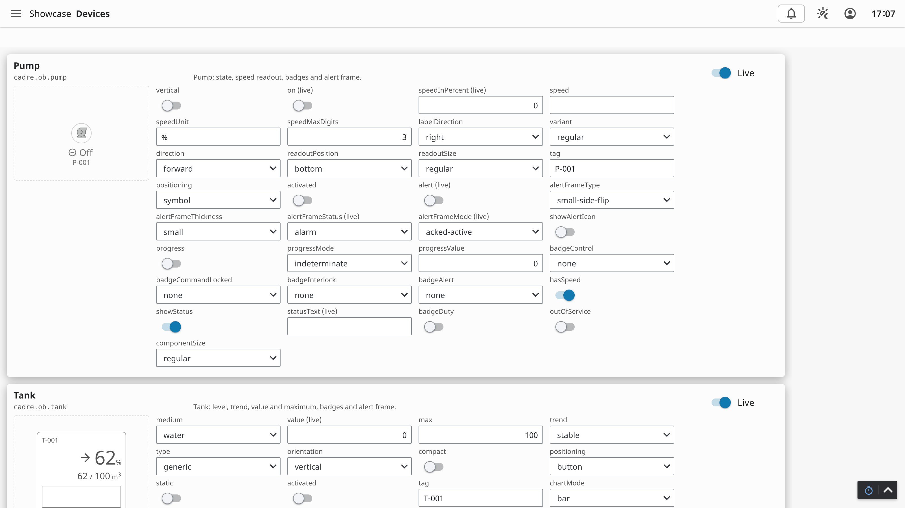

## 3. A Card

A card is one component with everything beside it, in one coord container per page (`Diagram`, as the sample pages use, so that gate G5 reads
it). From the left of the card:

1. The header: the palette title, the type id (`cadre.ob.pump`, or the view path) and the catalogue's one line description, and the Live switch
   at the right when the component has anything to simulate.
2. The stage: the component at its default size (the 48 px symbol box for a symbol, which draws its readout outside the box, as wiki 12
   measures), on a dashed ground. A stage wider than 520 px puts the editors below it.
3. The editors: a grid of three columns (four where the component has no events), a label and an input for every property of the component
   in the schema's order, each named `e_<card>_<property>` and carrying that name as its DOM id (`meta.domId`).
4. The event log, for a component with events: the last six lines.

### 3.1 The Editors

| Property of the component | Editor | Bound to |
|---|---|---|
| A string with an enumeration | Dropdown (`ia.input.dropdown`), the schema's values as its options | `props.value` |
| A boolean | Toggle switch (`ia.input.toggle-switch`) | `props.selected` |
| A number, or a number or null | Numeric entry field (`ia.input.numeric-entry-field`) | `props.value` |
| Any other string | Text field (`ia.input.text-field`) | `props.text` |
| An array or an object | Dropdown of named presets | `props.value` |

The wiring is in view custom properties, so that every key of the view's `propConfig` starts with `custom.` (GF-07). Each editor is bound
both ways to a custom property by a property binding, the shape of `schemas/bindings/binding-property.json` (`path` and `bidirectional`),
and the component reads the same custom property by a one way property binding:

| Custom property | Holds |
|---|---|
| `v_<card>_<property>` | the value of the property |
| `s_<card>_<property>` | for an array or object property, the name of the selected preset |
| `live_<card>` | the Live switch |
| `log_<card>` | the event log text |
| `tick` | `toMillis(now(1000))`, which the simulated arrays are scripted from |

A preset is chosen by name, and `v_<card>_<property>` follows `s_<card>_<property>` through a script transform that holds the presets as a
literal. The presets are the component test page's own samples for the component's kind (`FRAME_SAMPLE`, `GLYPH_DATA` and `GLYPH_EXTRA` of
`tools/hmi/testbench.py`: the first is the starting value, the others the cases of that page by their captions) and an empty value; a
property that page states nothing for takes a table of the generator's own (four alert records in the form of `scripts.alert_record`, a series
of numbers). A component's property is never stated beside its binding (GF-61), so every property is bound.

| Editors | Module components (97) | Library views (20) | Total |
|---|---|---|---|
| Dropdown of the schema's values | 606 | 72 | 678 |
| Toggle | 419 | 121 | 540 |
| Numeric field | 212 | 40 | 252 |
| Text field | 147 | 114 | 261 |
| Preset dropdown | 50 | 0 | 50 |
| All | 1,434 | 347 | 1,781 |

The 1,434 editors of the module's components are every property of `module/components.json`; a test holds the two equal. A library view's
editors are its scalar parameters (a boolean, a number, a string, or a null that is a nullable number); its enumerations are the library's own
tables (the readout sides of the contract, the variants, the alert and badge values the component test page draws), because a contract holds
defaults only. A parameter that holds a list or an object (the tank's `history`, the range bar's none) stays stated in the view.

### 3.2 The Simulation

The Live switch of a card, on by default, chooses what drives the properties that can be simulated: on, the live source; off, the property's
editor. A property that is live says so in its label (`on (live)`), and its binding is `if({view.custom.live_<card>}, (<live>),
{view.custom.v_<card>_<property>})`, so that the editor keeps its value and takes over when Live goes off.

| Component | Live source |
|---|---|
| Any component with the property | Expressions over `now(1000)`: `on` and `open` toggle every few seconds, `alert` pulses, `value`, `speed`, `speedInPercent`, `level`, `secondaryLevel` and `secondaryValue` follow a sine between 10 and 90, `nAlerts` steps from 0 to 5 |
| The area and line graphs, the donut, pie, polar and radial bar charts, the battery and the atmospheric tank | The series: a script transform on `custom.tick` builds the data array each second |
| The 11 devices of the device page | The device's own tags: the state, speed, level and alarm states of the samples, which the faceplate's commands and the test alarms change |

The device page binds its components as the component test page does (`screen.embed_symbol` with `--render module`): the memory and
expression tags of the folder `[default]cadre_hmi_showcase/_componentTest` (test devices `TB_PUMP`, `TB_MOTOR`, `TB_FAN`, `TB_VALVE`,
`TB_AVALVE`, `TB_DAMPER`, `TB_TANK`, `TB_READOUT`, `TB_FIELD`, `TB_GEN` and the alarm lamp `ALM_HIGH`), the polled alarm states, and the click
that opens the faceplate. Start the pump on its faceplate and its card follows; with Live off the editors take over. The filter has no device
kind in the library and so no faceplate; the button is a command element of a view and has none.

### 3.3 The Event Log

A component event is a Perspective component event (GF-37): the module component fires it from the browser, and a script action configured on
the component runs on the gateway with the payload as `event`. Each of the 94 events of the 33 components that have events has a handler of
that form (`events.component.<name>`, as `obframe.py` writes them), which writes one line (the time, the event name and the payload as JSON) at
the top of `custom.log_<card>` and keeps six. The log is a label bound to that property. Clicking a component writes to its log; a menu's row, a
button, a switch or a pivot item does so by its own event.

## 4. Building, Deploying and Importing

```bash
python tools/hmi/parent.py --out build                                   # the parent
python tools/hmi/showcase.py --out build --deploy                        # gates G0 to G7 offline, then the tags and the project
python tools/hmi/showcase.py --out build --export cloud/release          # the zips and the tags for an import
```

`showcase.py` takes `--faceplate` (default `asm`; see section 6), `--name`, `--parent`, `--write-descriptor DIR` (the device page's descriptor,
which gate G11 reads, and the model of the project, which the functional check reads) and `--write-devices FILE`. The importable files are in
`cloud/release/` with their steps (`cloud/release/README.md`): the parent first, then the device tags, then the showcase, with module 0.8.0
installed; a gateway import drops the identity provider (GF-44), which `--deploy` sets and an import by hand sets in the Designer.

## 5. Gate Results

On the cloud gateway, after a deploy of the parent and the showcase and in a new session for each page (GF-10):

| Gate | Result |
|---|---|
| G0 to G7 (offline, run by `showcase.py`) | All pass: G1 registry (the 97 module components and the parent), G2 references, G3 view keys, G4 project, G5 layout, G7 faceplates, history, commands, interlocks, tag libraries and devices (11 devices, 11 device symbols). G6 and the contract gate belong to descriptor pages and are not run |
| G8 render (`capture.py`, a fresh session for each page) | 12 of 12 pages pass: no view error badge, no quality overlay, 96 to 824 components rendered on a page |
| G11 faceplate sweep (`faceplates.py`, device page, `--faceplate asm`) | Pass: 11 of 11 devices open their faceplates, no missing or unexpected faceplate, no fault, no quality overlay |
| Functional check (`showcase_check.py`) | 12 of 12 pages pass: 54 editor kinds checked (an editor of each kind a page has, 54 of 54 changed the component's rendered DOM, from 87 edits tried), 33 of 33 evented components wrote a line to their log, no page error |
| Unit tests (`python -m unittest discover -s tests`) | 1,333 pass (1,321 before, 12 added in `tests/test_showcase.py`) |

Screenshots (device scale factor 2, 3200 by 1800 px, palette PNG of 66 to 127 KiB) are in `wiki/img/showcase/`, one for each page:
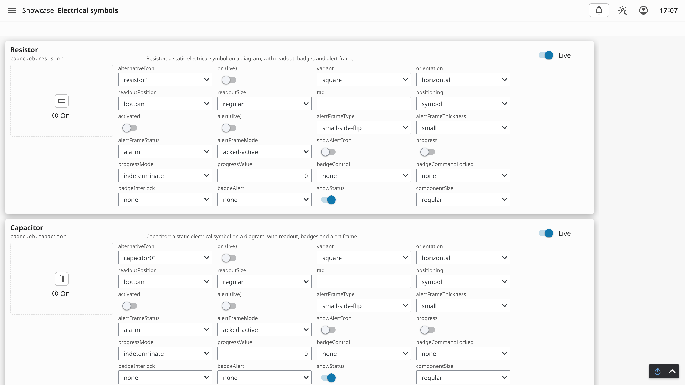
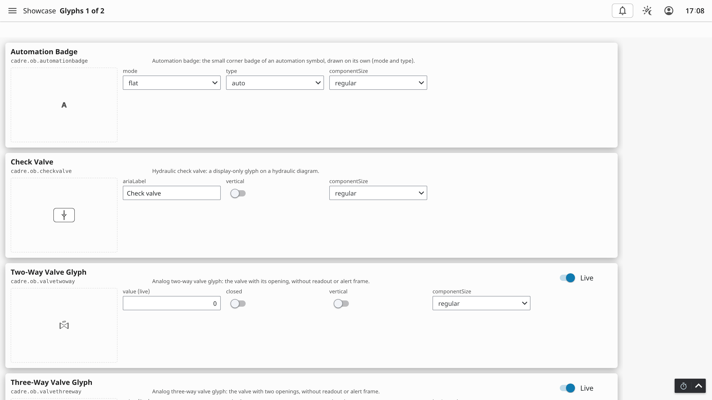
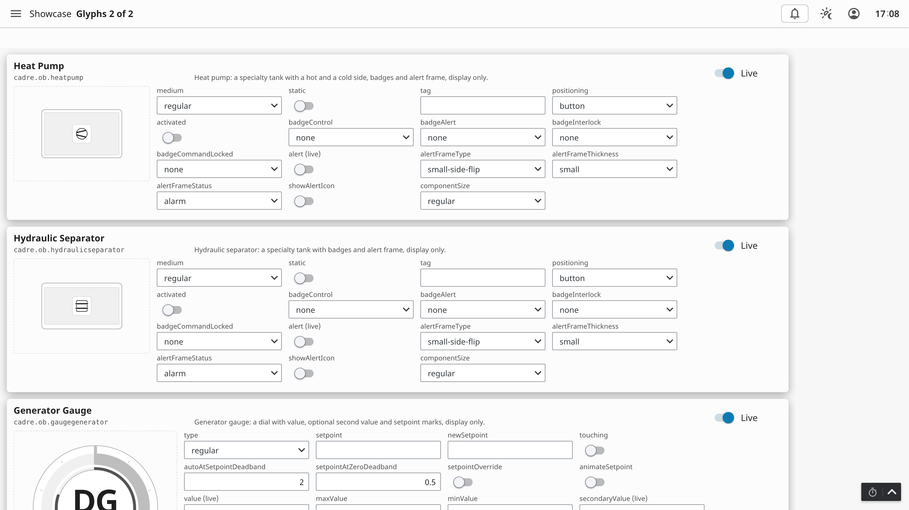
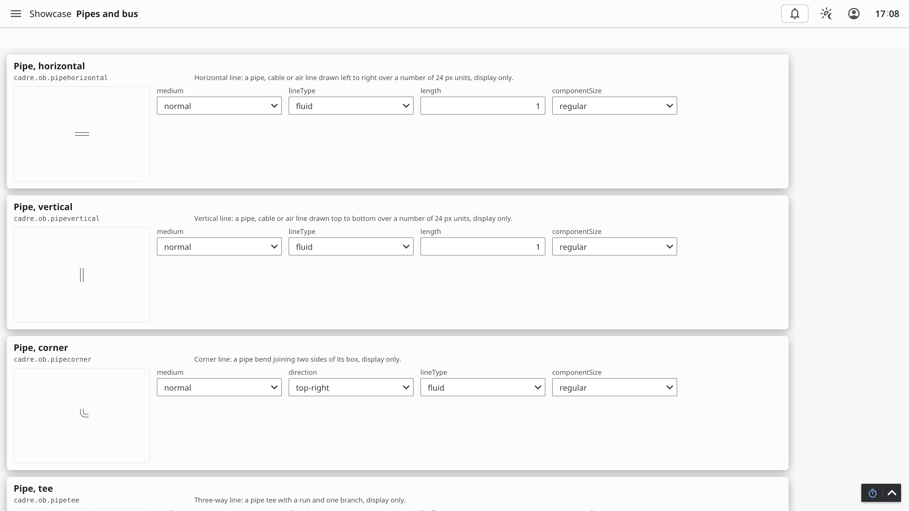
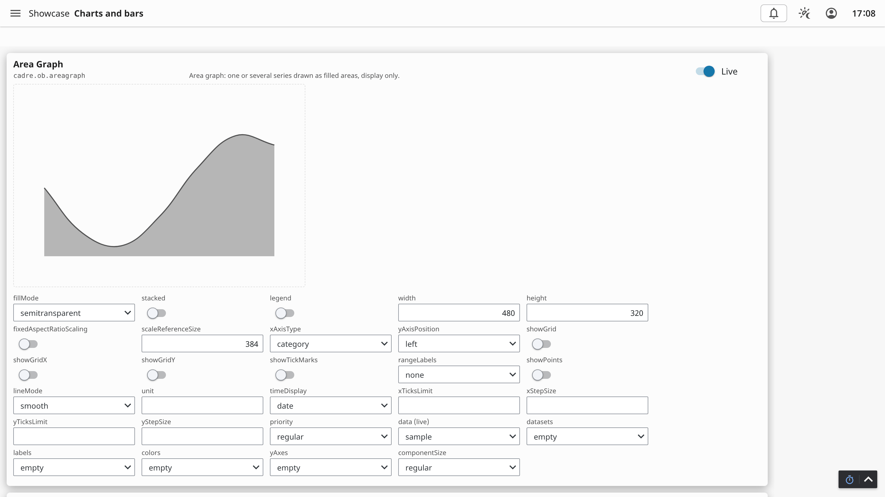
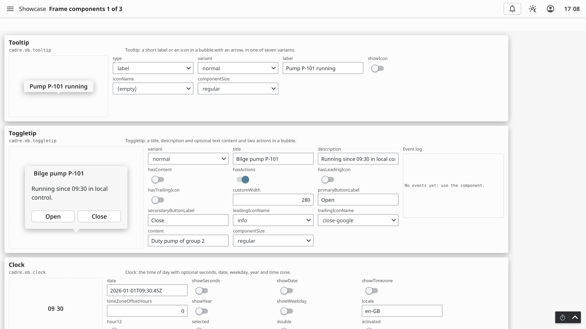
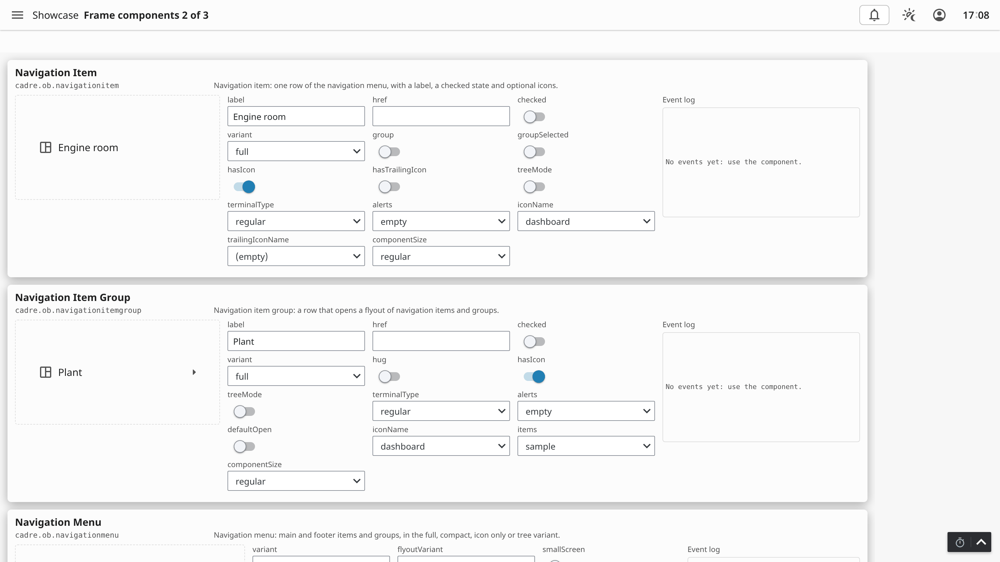
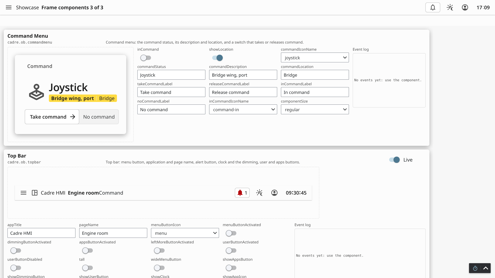
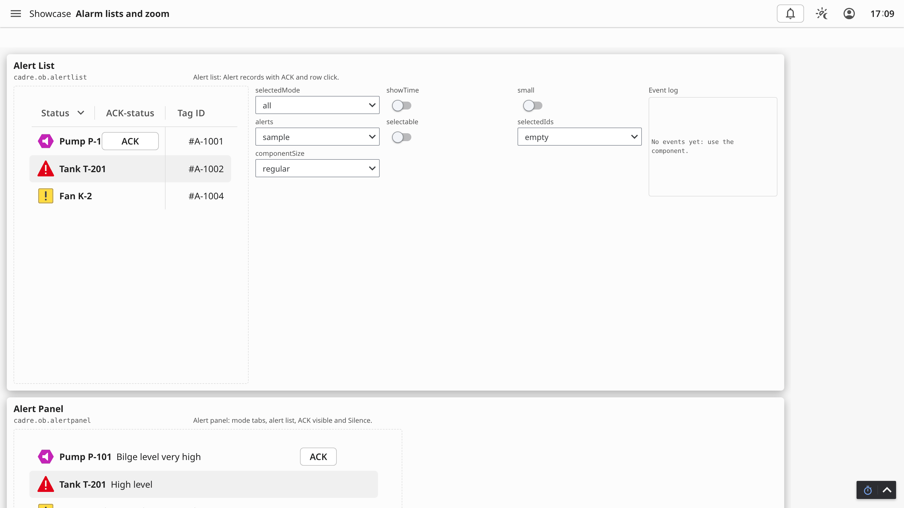
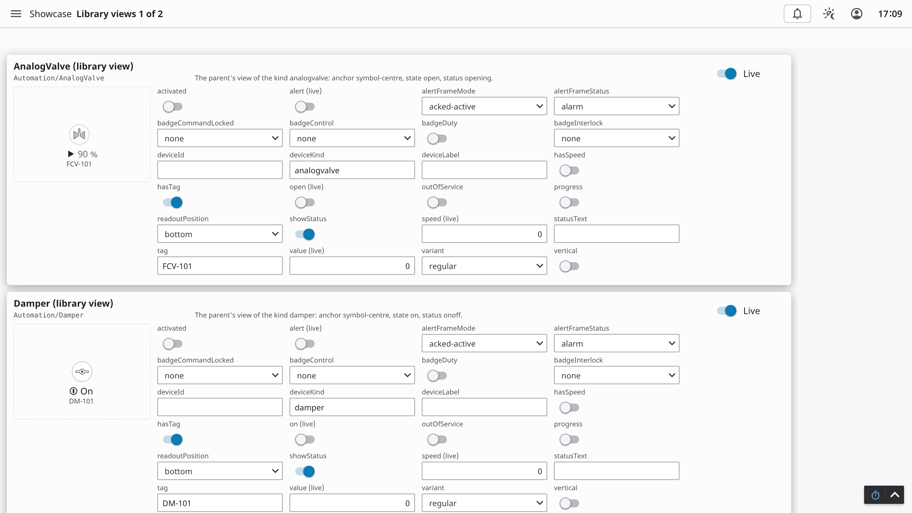
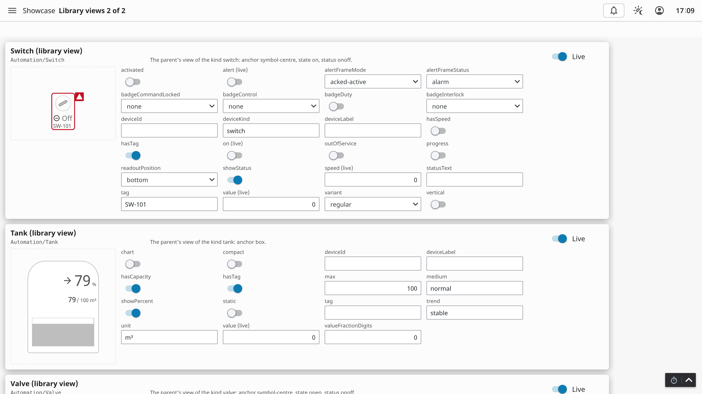

## 6. Findings

1. The test devices carry modes (Program, Operator, Maintenance, Local), and the sweep judges their faceplates by the project's faceplate style.
   Under `--faceplate openbridge` the sweep reported a Maintenance tab on the pump, the motor and the valve that the device model's members do
   not give (`framework.expected_tabs`); under `--faceplate asm` it does not apply (Maintenance is a move beside Take control, never a tab) and the
   sweep passes, as it does on the component test page. The showcase therefore sets `faceplateStyle` to `asm` and the sweep to `--faceplate asm`.
   The mismatch under the older style is reported here and not changed in the sweep.
2. The numeric field of Perspective is read only until it is clicked, and a text field commits on Enter or blur; the functional check drives
   both as a user does.
3. A press and hold switch (the command menu's) answers the keyboard, not a click: its event fired from the space key.
4. A value that draws only in a state of its card (`progressValue` needs `progress` and the determinate mode) shows no change from its own
   editor alone; the check sets the state first and says so in its record.
5. The canvas zoom draws nothing: it turns the wheel, a pinch and Ctrl with plus or minus over a target element into its `zoom` property
   (`module/web/canvaszoom.js`). Its card therefore holds a target box of its own that the page scales by that property, bound both ways, so
   that a gesture moves the editor and the editor moves the box; the check asserts the target's DOM.

## 7. Open Items

1. A numeric editor that is cleared writes null, which a component with a non-null number reads as it is. The editor does not coalesce.
2. An array or object property has presets, not a field for each element; a user who needs another record edits the view's custom property in the
   Designer. The two pages of library views carry no faceplate and simulate only the properties named in section 3.2.
3. The pages are tall (1,628 to 6,664 px) and scroll; the screenshots show the top of each.
4. The showcase is generated for module 0.8.0; a new component joins the catalogue and the page grouping changes with it (the test
   `test_page_grouping_is_stable` records the grouping and is changed deliberately).
